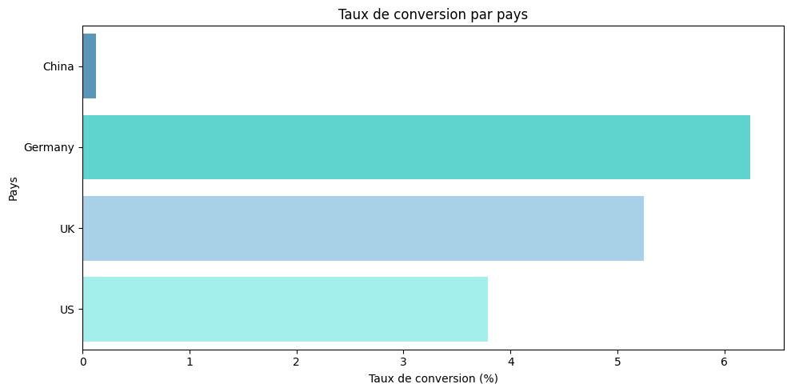
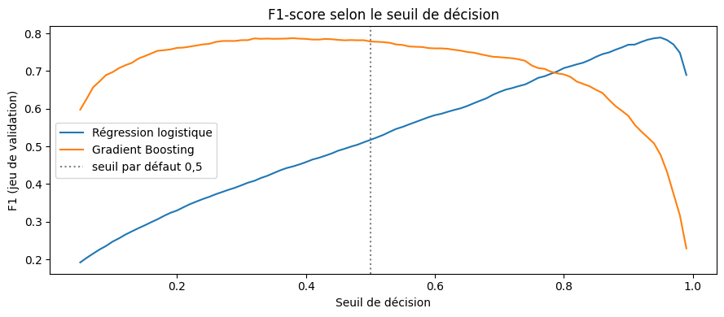
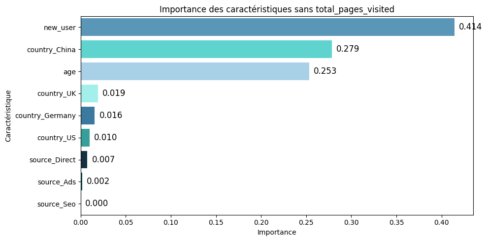

# Comprendre ce qui fait s'abonner à une newsletter

📰 Marketing digital · Analyse prédictive · Projet du module Machine Learning (Jedha, Data Analysis Fullstack), juillet 2026, en individuel.

L'équipe d'une newsletter veut savoir qui s'abonne sur son site, et surtout sur quoi agir pour convertir plus de visiteurs. J'ai débuté professionnellement en vente chez un opérateur télécoms : transformer un contact en client, c'est une question que je connais. Ici, le client est un visiteur de site web, et il faut comprendre ce qui le fait passer à l'abonnement.

## Contexte

Le jeu de données décrit 284 580 visites. Pour chaque visiteur, on ne connaît que cinq informations : son pays, son âge, s'il vient pour la première fois, par où il est arrivé (publicité, moteur de recherche ou accès direct) et le nombre de pages qu'il a vues. Seuls 3,2 % des visiteurs se sont abonnés.

## Objectif

1. Construire un modèle qui prédit si un visiteur va s'abonner. Le challenge impose le **F1-score** pour le noter.
2. Identifier ce qui est associé à l'abonnement.
3. En tirer des pistes d'action pour l'équipe.

Avec seulement 3,2 % d'abonnés, un modèle qui répondrait « personne ne s'abonne » aurait raison 97 fois sur 100 tout en étant inutile. Je regarde donc la précision (quand le modèle annonce un abonné, a-t-il raison ?) et le recall (combien de vrais abonnés il repère), plutôt que le taux de bonnes réponses global.

## Données

- Source : données fournies par Jedha pour le challenge (`conversion_data_train.csv` avec la réponse, `conversion_data_test.csv` sans la réponse)
- 284 580 lignes, 6 colonnes, aucune valeur manquante
- 2 lignes retirées : des âges supérieurs à 100 ans

Le pays est le premier écart visible. La Chine représente un quart du trafic, mais seulement 0,13 % de ses visiteurs s'abonnent, contre 6,2 % en Allemagne. Autre écart fort : les visiteurs qui reviennent s'abonnent cinq fois plus que les nouveaux (7,2 % contre 1,4 %).



## Méthodologie

1. **Exploration** : taux de conversion et effectifs par pays, par source et par type de visiteur.
2. **Préparation** : découpage 90 % entraînement / 10 % test en gardant la même proportion d'abonnés.
3. **Modèles** : une régression logistique, une Random Forest et un Gradient Boosting, d'abord avec le nombre de pages vues seul, puis avec toutes les variables. Rééquilibrage des classes testé avec `class_weight="balanced"` et SMOTE.
4. **Choix du seuil de décision** : au lieu de garder le seuil de 0,5 par défaut, je teste tous les seuils sur une partie du jeu d'entraînement mise de côté, et je garde celui qui donne le meilleur F1.
5. **Un modèle sans le nombre de pages vues**, pour voir ce qu'on peut dire d'un visiteur dès son arrivée sur le site.

## Résultats

| Modèle | Seuil | F1 | Précision | Recall |
|---|---|---|---|---|
| Régression logistique | 0,5 | 0,51 | 0,35 | 0,94 |
| Régression logistique | 0,95 | 0,77 | 0,80 | 0,74 |
| Gradient Boosting | 0,5 | 0,76 | 0,85 | 0,70 |
| **Gradient Boosting (retenu)** | **0,38** | **0,77** | **0,79** | **0,75** |

*Jeu de test de 28 458 visites, dont 918 abonnés.*

Au seuil par défaut, la régression logistique semblait bien moins bonne que le Gradient Boosting. En réalité, elle repérait presque tous les abonnés, mais se trompait deux fois sur trois quand elle en annonçait un. Une fois son seuil réglé, elle fait jeu égal avec le Gradient Boosting. C'est le résultat qui m'a le plus surpris : **sur ce projet, le réglage du seuil a compté plus que le choix du modèle.**



Le modèle retenu repère 684 abonnés sur 918, avec 180 fausses alertes.

Dans ce modèle, le nombre de pages vues pèse 90 % de l'importance. Mais un visiteur déjà décidé à s'abonner lit forcément plus de pages : cette variable annonce l'abonnement, elle ne prouve pas qu'elle le provoque. Sans elle, le modèle ne sait plus dire qui va s'abonner, mais il fait ressortir ce que l'équipe connaît dès l'arrivée du visiteur : le fait qu'il revienne ou non, son pays (surtout la Chine) et son âge.



## Recommandations

- Suivre le nombre de pages vues comme indicateur d'engagement, et tester par un A/B test si un parcours de lecture enrichi fait vraiment monter l'abonnement avant d'y investir.
- Comprendre pourquoi la Chine ne convertit presque pas avant toute action : langue du site, accès, contenu.
- Travailler le retour des nouveaux visiteurs, puisque ce sont les visiteurs qui reviennent qui s'abonnent.
- Cibler l'Allemagne et le Royaume-Uni, les pays qui convertissent le mieux.
- Ne pas revoir le budget marketing sur la seule base de la source d'arrivée : son effet est faible.

## Ce que j'ai appris

J'ai repris ce projet après les retours de mon teacher assistant. Dans ma première version, je concluais que la régression logistique était trop simple pour ce problème. En ajoutant la précision, le recall et la recherche du seuil, j'ai compris que le modèle n'était pas en cause : c'est la barre à 0,5 qui était mal placée. J'ai aussi appris à me méfier de la variable la plus prédictive : elle était surtout le signe d'un visiteur déjà convaincu, pas un levier d'action.

## Limites

Ce sont des associations, pas des causes démontrées : chaque piste est à valider par un test. Les modèles ont été évalués sur un seul découpage des données, et les meilleurs sont trop proches pour être départagés. Le préprocessing pourrait aussi être intégré avec le modèle dans une même `Pipeline`. Enfin, avec seulement cinq variables, le score plafonne autour de 0,77.

## Contenu du dépôt

```
newsletter-conversion/
├── images/                              graphiques du README
├── Prediction_taux_conversion.ipynb     notebook complet
├── requirements.txt
├── .gitignore
└── README.md
```

Les fichiers de données ne sont pas inclus. Pour relancer le notebook, placez `conversion_data_train.csv` et `conversion_data_test.csv` dans un dossier `data/` à côté du notebook (sur Google Colab : créez un dossier `data` dans l'espace de fichiers), puis lancez « Exécution > Tout exécuter ». En local : `pip install -r requirements.txt`, puis ouvrez le notebook dans Jupyter.

## Auteur

Projet réalisé par Cyril Carel ([LinkedIn](https://www.linkedin.com/in/cyril-carel-532680209)).
